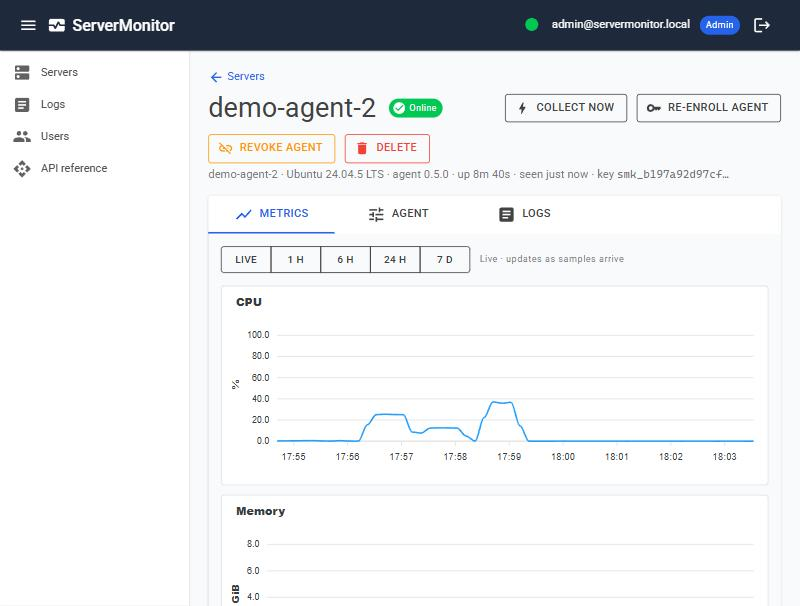
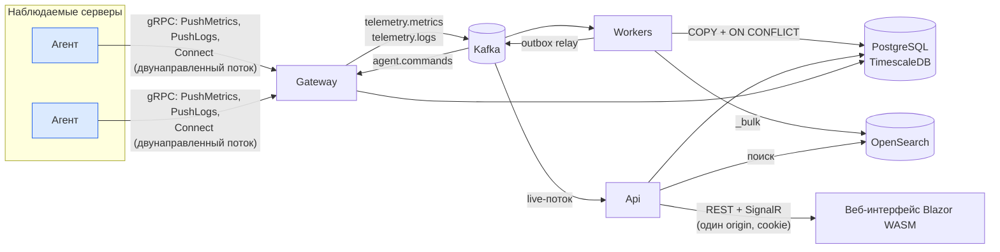
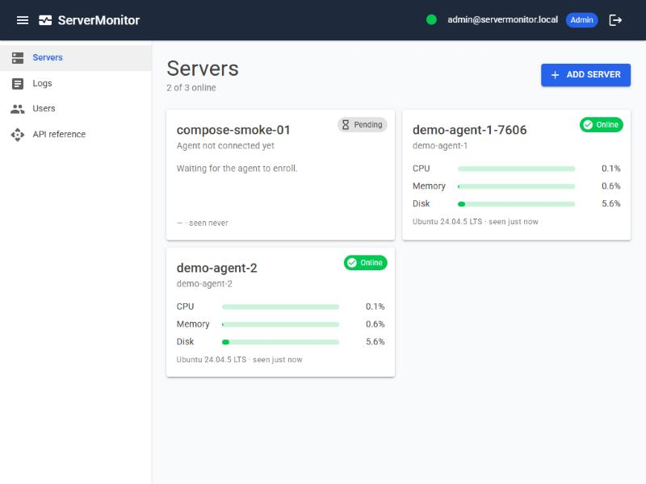
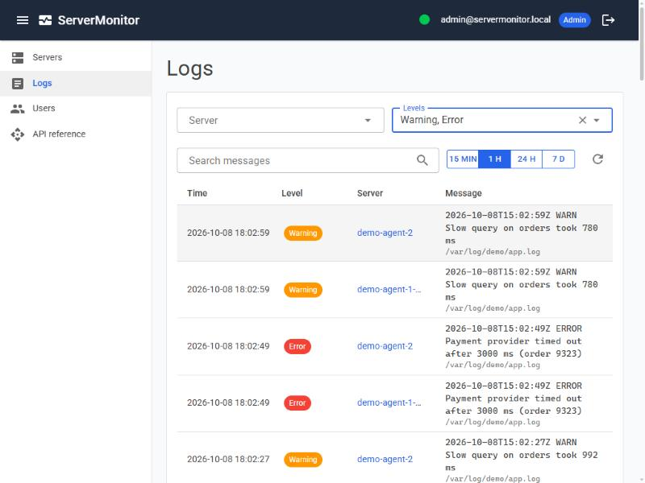

# ServerMonitor


Распределённая система мониторинга серверов. На каждом сервере (Linux или Windows) работает лёгкий
агент, который отправляет метрики и логи на центральный сервер на .NET. Данные отображаются в
веб-интерфейсе в реальном времени.

**Стек:** .NET 10 · ASP.NET Core (Minimal API, gRPC, SignalR, Identity) · Kafka ·
PostgreSQL + TimescaleDB · OpenSearch · Blazor WebAssembly · Docker Compose




## Архитектура



- **Gateway, Api и Workers** — отдельные процессы одного приложения с общей базой данных, разделённые
  по характеру нагрузки
- **Чистая архитектура:** `Domain ← Application ← Infrastructure ← хосты`. Правила зависимостей между
  слоями проверяются архитектурными тестами; агент зависит только от проекта Protocol.


## Быстрый старт

Нужен Docker (стеку требуется около 3 ГБ оперативной памяти).

```bash
docker compose up --build
```

- Веб-интерфейс: http://localhost:5080. Вход: `admin@servermonitor.local` / `ChangeMe-123`;
  переопределяется переменными `ADMIN_EMAIL` / `ADMIN_PASSWORD`. Эти значения только для локального запуска.
- Документация API (Scalar): http://localhost:5080/scalar
- Шлюз для агентов: gRPC на `localhost:5090`, health-check на http://localhost:5091/health
- Для локальных инструментов: Kafka — `localhost:9094`, OpenSearch — `localhost:9200`, PostgreSQL — `localhost:5432`

### Подключение агентов

1. В веб-интерфейсе нажмите **Add server**. Откроется окно с одноразовым токеном регистрации и
   готовыми командами.
2. Запустите первого демо-агента с этим токеном. Вместе с ним запускается генератор, который пишет
   тестовый лог приложения

3. Для каждого следующего сервера — отдельный контейнер (команда есть в том же окне)


Агент обменивает токен на API-ключ и сохраняет его в своём каталоге данных, поэтому при следующих
запусках токен не нужен. 

### Настройки агента

Задаются в `appsettings.json`


Интервал сбора метрик настраивается централизованно в веб-интерфейсе и сразу отправляется подключённым агентам.

### Скриншоты

| Список серверов | Логи |
|---|---|
|  |  |

## API

Всё, что делает веб-интерфейс, доступно через REST API (аутентификация по cookie, политики Admin/Viewer).
Основные методы:

- `GET /api/servers`, `POST /api/servers`, `POST /api/servers/{id}/enrollment-tokens`, `DELETE /api/servers/{id}/agent-keys`
- `GET /api/servers/{id}/metrics?from=…&to=…&resolution=auto|raw|1m|1h`, `GET /api/metrics/latest`
- `GET /api/logs?serverId=…&levels=Error,Warning&q=timeout&from=…&to=…&limit=50&cursor=…`
- `PUT /api/servers/{id}/configuration` с телом `{ "metricsIntervalSeconds": 30 }`
- `POST /api/servers/{id}/commands` с телом `{ "type": "CollectNow" }`

